MENG4030 Embedded Parallel Programming Project 1 - SPRINT Summaries 
Hudson Paquet N01554102 2026/09/21 - 2026/10/23
--------------------------------
SPRINT 1
--------------------------------
Part II: Blink LED (baremetal)
•	Figure 1 and 2
o	STM32CubeMX – Starting the project with STM32CubeMX allows the user to configure individual pins, which was a key component of this lab. </n>
While beginning the project by selecting the correct board in the software will configure all the correct timers, etc. </n>
It does not default to correctly configuring GPIO pins, which is necessary for LED Toggling. </n>
o	STM32CubeIDE – After the pin was configured and the corresponding code was generated, the correct lines of code needed to be added to the while loop to run infinitely. 
The code in the while(1) loop in Figure 1 shows a toggle of GPIO Pin 5 on Port A every 1000ms. This was done using the HAL embedded library that allows for direct interface with the GPIO pins.
_________________________________
Part III: Serial output
•	Figure 1 and 2

o	STM32CubeMX – As mentioned, starting the project with STM32CubeMX allows the user to configure individual pins, as it does not default to correctly configuring UART pins, 
which is necessary for the serial output to occur. For this, Pin 2 on Port A was configured to be the UART Transmitter and Pin 3 on Port A was configured to be the UART receiver.
o	STM32CubeIDE – After the pins were configured and the corresponding code was generated, the correct lines of code needed to be added to the while loop to run infinitely. 
Under the code that toggles the LED in the while(1) loop, is the correct structure to output the “Hello World!!!” character string seen in the serial monitoring terminal. 
Similar to the LED toggle, the HAL library was used to transmit the string over serial communication
_________________________________
Part IV: Blink LED using RTOS
•	Figure 3 and 4

o	STM32CubeMX – Previously, CubeMX was used for configuring pins. For this, the “FreeRTOS” kernel is needed to define RTOS tasks that will handle the blinking rather than plan script in a super loop. 
2 Tasks were defined in the respective fields, two tasks that will each toggle the LED. One task with a higher priority over the other, to create an imbalance in the frequency each task is called upon to execute.
o	STM32CubeIDE – After the tasks were configured and the corresponding code was generated, instead of writing code in the super loop. The code is written in the task definition that is generated by CubeMX. 
Again using the HAL library to do this, with each task to execute the same function (‘Toggle Pin’). **Observation** Changing priorities of the tasks create a different pattern of blinking because of the timing and 
frequency each task is called. 

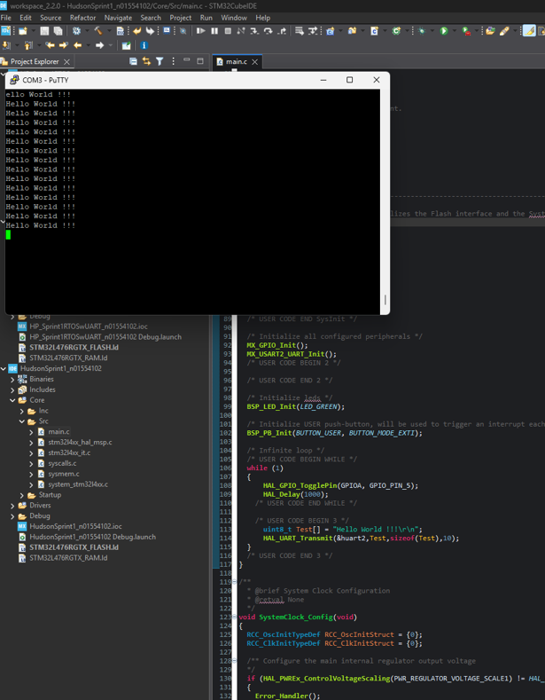
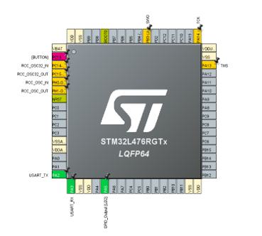
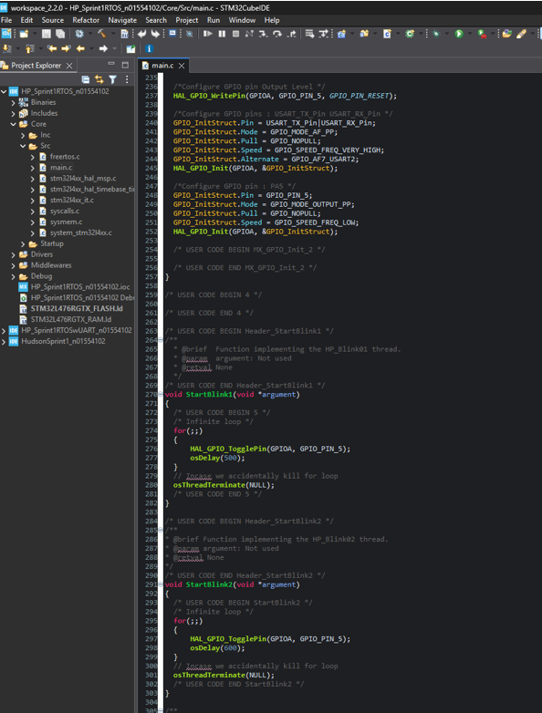
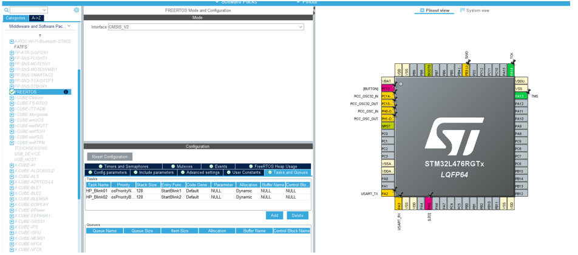

--------------------------------
SPRINT 2
--------------------------------
Part 1A: Interface with I2C TMP3 Sensor (baremetal)
•	Figure 5, 6 and 7
•	Explanation:
o	STM32CubeMX – Using a similarly configured .ioc file for this project, there is an additional configuration for the I2C peripheral. The default settings for this peripheral were sufficient, ensuring pins PB8 and PB9 were configured for the I2C SCL (Clock) and SDA (Data) communication pins respectively.
o	STM32CubeIDE – 2 major blocks of code were needed here, one to initialize a function to read the raw I2C data from the bus (Figure 6), and one to output the temperature value to the UART (Figure 7).  
	Figure 6 – Using the I2C Master Transmit and I2C Master Receive from the HAL library the interfacing with the I2C bus is simply a function call and specifying the I2C address of the device (0x48 << 1), and where the data is stored locally. Ensuring proper communications along the way by checking the value of “ret != HAL_OK” which would return true if there was an issue. For data conversion, the raw value is converted to 2’s compliment because it can be negative. Then converted to celsius given the resolution of the TMP3 Sensor. 
	Figure 7 – Simple UART transmission using HAL library similar to previous sprint. 
___________________________________________________
Part 1B: Convert to FreeRTOS
•	Figure 8, 9 and 10
•	Explanation:
o	STM32CubeMX – Using a similarly configured .ioc file as Part A, but including FreeRTOS.
o	STM32CubeIDE – Manually creating the RTOS task involves using the XTaskCreate function, ensuring to include the function containing the code to execute, the task name, stack size, priority and handle. The only arguments needed for this task specifically is the function, task name, stack size and priority. Doing this allows for the an RTOS style operation of the temperature reading with task calling by the scheduler, instead of blindly running in a loop.
___________________________________________
Part 2: Create a sensor task for your specific project
•	Figure 11, 12, 13 and 14
o	STM32CubeMX – Enable Pin PC13 for GPIO_EXTI13 (Blue Button)
o	STM32CubeIDE – 
	NAU7802.c - To properly read data from the NAU7802 (ADC for the load cell), an initialization of the chip must occur, including the user created NAU7802 file allows for a clean setup of the system in the main.c. The file starts with a specific startup routine required for the NAU7802 to operate (Figure 14), this routine performs certain operations like a device reset, powering up of the analog and digital circuit, configuring the ADC register. All done according to the datasheet fo the NAU7802. The file also predefines a function to read the raw data from NAU7802 (figure 13) utilizing the HAL library to do so. 
	Main.c - The steps here are similar to the previous part of the sprint, using xTaskCreate to define the task (Figure 11) and the function containing the code to be executed and the function itself reading the I2C bus and printing the value on the UART (Figure 12). Also included is the ability to tare the load cell reading by using the “USER” button on the STM32 board. Also required here was a calibration value (defined in main.c as 760), this was found by assuming the load cell is linear and placing a known weight on the load cell, finding the ratio with respect to grams. 

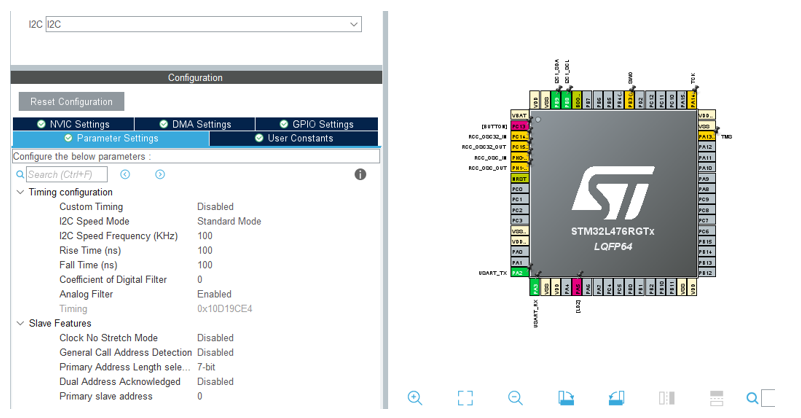
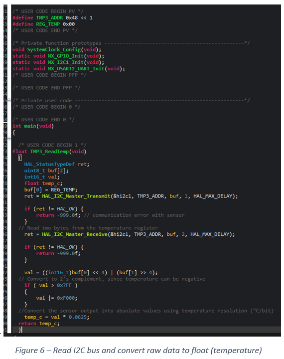
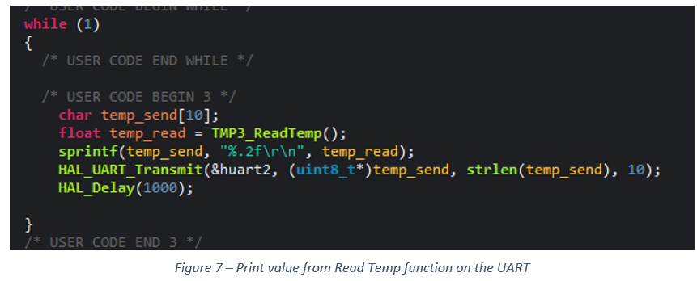
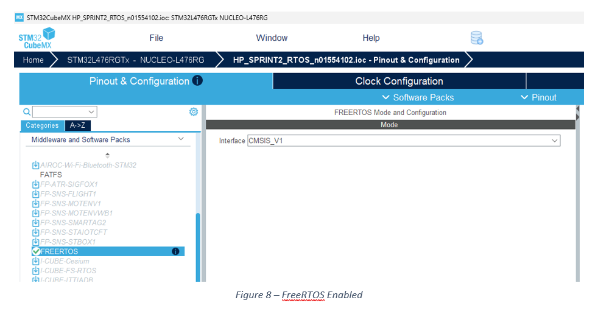
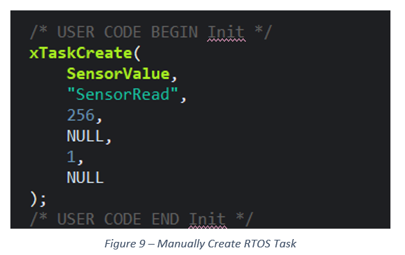
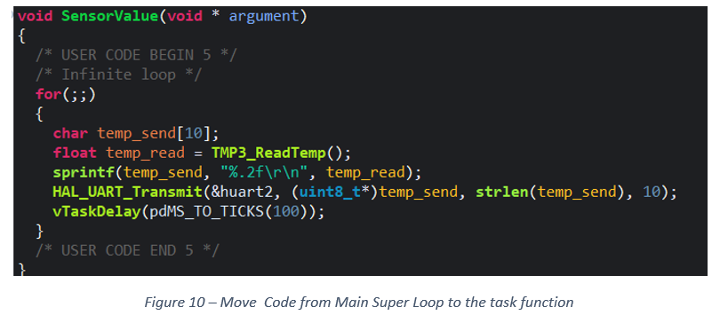
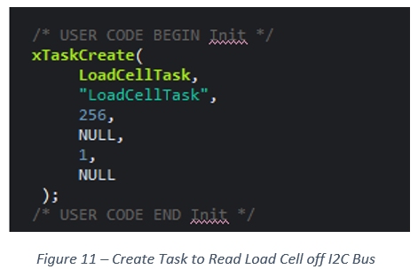
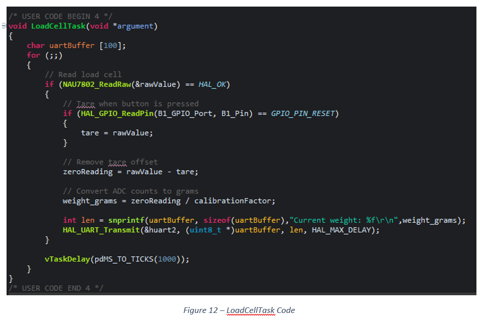
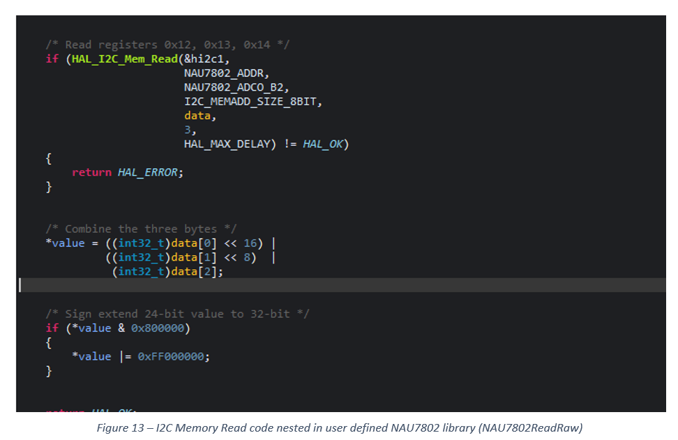
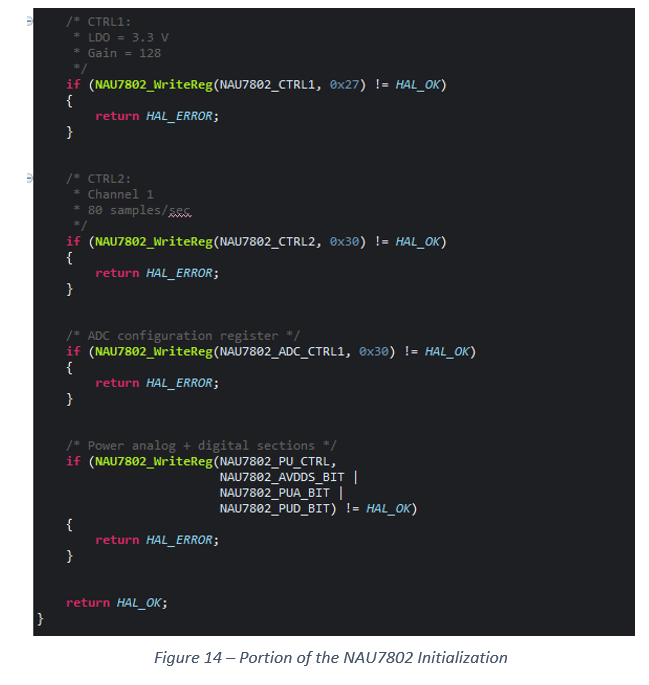
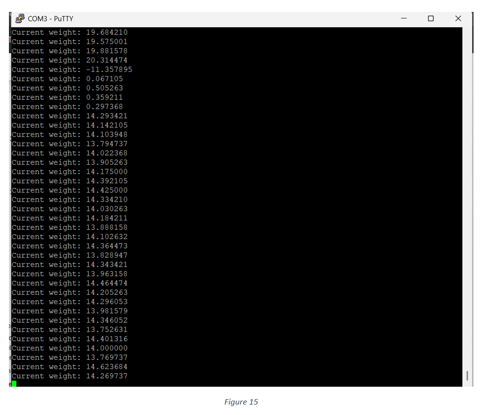

